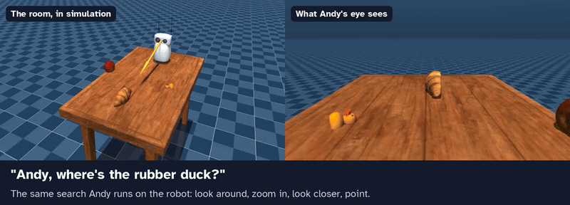
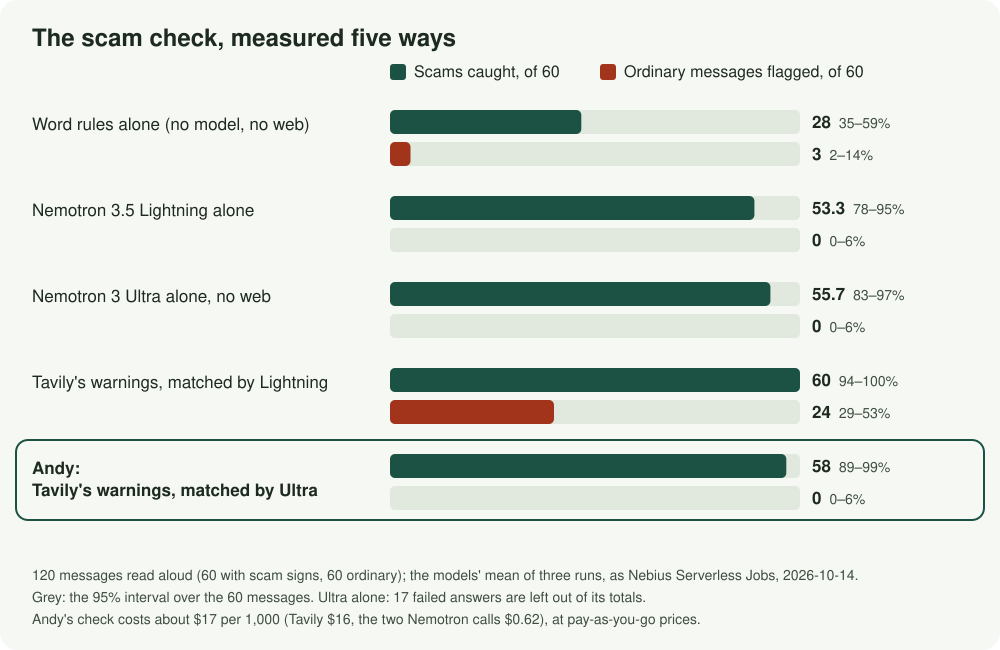
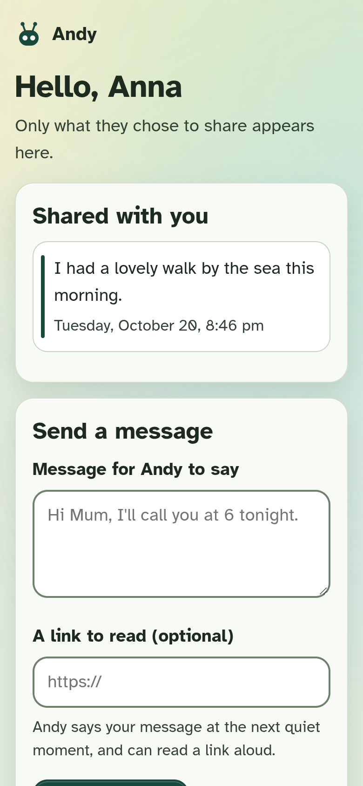

# Andy

**A small home robot for older adults who live at home, and the family who help.** It reads the letter in your
hand and looks around the room for your glasses. Built with NVIDIA Nemotron on Nebius
Token Factory, and Tavily, on a Pollen Robotics [Reachy Mini](https://huggingface.co/blog/reachy-mini). It says it's a
robot, and keeps no recordings or transcripts: only what you ask it to keep.

**[Try guided AI examples, no keys](https://huggingface.co/spaces/andydm/andy-companion-judge)** ·
**[Open Andy's screens](https://huggingface.co/spaces/andydm/andy-companion)** ·
**[Ask to see the real robot live](https://github.com/AndyDM9/andy-companion/issues/new?template=live-demo.yml)** ·
**[Read every scorecard](evals/results/README.md)**

**[Testing instructions for judges](docs/judging.md):** a short route through the public demo,
an anonymous fresh install, the tests and optional model evaluations, with expected results and limits.

**Review status, October 27:** public software demos and reproducible tests are available. The
real-robot video, photographs and remaining [physical checks](docs/judging.md#what-is-still-pending)
are pending. The images below use sample data; the search animation is simulation.

**Why a robot, not a smart speaker?** Andy looks at you while you talk and turns as you move. When it
shows you something on the TV it turns its head to the screen, so your eyes follow. It reads the letter
in your hand. Ask where your glasses are, and it looks around the room and points at them with its head.

- **1.06 s** median from the moment your words are understood (Parakeet's transcript) to Andy's first sound, over 54 real turns on the robot ([scorecard](evals/results/robot-timings-2026-10-20-1550.json))
- **58 of 60** scams caught and **none of 60** ordinary messages flagged: Tavily's warnings judged by NVIDIA Nemotron 3 Ultra, as Nebius Serverless Jobs ([scorecard](evals/results/scam-eval-2026-10-14-1200-nebius-jobs.json))
- **92, 93 and 94 of 97** text cases for the current profile as a Nebius Serverless Job, with the real confirmation gate around synthetic tools; earlier runs today scored 91, 95, 95 and 94, 93, 92 ([current](evals/results/2026-10-28-nebius-job-andy-suite-20261028-121449.json), [every run](evals/results/README.md))
- **About $2.30 a month, estimated** from list prices, for one household's conversation and web lookups ([cost](docs/cost.md))

**What's new here:**
- **A language model that moves a robot's head to find things in a room,** with nothing trained: it looks around,
  zooms in, looks closer and points, and it is tested in simulation as Nebius Serverless Jobs.
- **A scam check for where scams reach people at home:** the letter in your hand or the call you mention, with the
  warning's source named.
- **Rules in code under the model:** **Be careful** on a risky letter whatever the model says, consent before
  anything is remembered, and no recordings or transcripts.

**Judging it without a robot:** the real-robot video is still pending. Watch the
search above, from Andy's own code and live model calls, and rerun it with a Token Factory key ([sim/](sim/README.md));
try [three guided AI examples](https://andydm-andy-companion-judge.hf.space/) with real Nemotron replies
and simulated camera/search/family effects, funded by the author with no visitor key;
open the screens on sample data with no keys at all ([try it](#try-it-without-a-robot)); read every scorecard,
failures included ([evals/results/](evals/results/README.md)); or [ask for the real robot live on a video call](https://github.com/AndyDM9/andy-companion/issues/new?template=live-demo.yml),
any time until 2026-12-15.
Organiser-requested physical access is arranged separately; a video call is not a confirmed substitute.
The author operates the supporting computer; judges do not need personal desktop or API credentials.

**Contents:** [three moments](#three-moments), [what Andy does](#what-andy-does), [every model and where it runs](#every-model-and-where-it-runs), [how it uses NVIDIA and Nebius](#how-it-uses-nvidia-and-nebius), [measured](#measured-reachy-mini-lite), [what runs where](#what-runs-where-and-why-that-model), [privacy](#privacy), [accessibility](#accessibility), [path to shipping](#path-to-shipping), [limitations](#limitations), [try it without a robot](#try-it-without-a-robot), [setup](#setup), [licences and credits](#licences-and-credits).

## Three moments

**"Can you read this for me?"** You hold up a letter. Andy reads it on this computer and explains it,
and the TV shows it in large print. If the page asks for gift cards or rushes you, code (not the model)
puts **Be careful** first, and Andy never sees or reads out the page's account, phone or reference numbers.

**"Where did I leave my glasses?"** Andy looks around the room. NVIDIA Nemotron 3.5 Super VL on Token Factory
reads the four views zoomed in, each as six tiles at the camera's full resolution (24 at once, about 1.8 s). Then
Andy looks closer: it turns its head straight at what it saw, takes a close-up and checks it, and only then points
at them and says "I think I see your glasses, on the table…". At the desk, on nine versions of one room photo with a
real pair of reading glasses in it, the old way (one shrunk picture per view) found them in 0 of 9, zoomed in 9 of 9,
with no false sighting in the nine without them: a direction, not a rate
([how we measured](docs/research.md#finding-small-things-zoom-in-then-look-closer-researched-2026-10-20)). The TV shows the picture it saw them in, held in memory for two
minutes and never saved.

**"Could you look into whether the farmers market is on this Saturday?"** Andy starts Tavily's research
agent and carries on talking. The TV shows each step as it happens, and Andy tells you the dated answer
with its sources. "Stop looking" or "never mind" stops it at once.

## What Andy does

- **Talks and keeps looking at you**, in English or Spanish, with body language from research: its
  antennas lift while you speak and lean while it thinks.
- **Notices the room by itself** (new; waving back tried on the robot, turning to a voice not yet): when someone else speaks from the side, Andy turns to them (and back if nobody is
  there, such as the TV); wave at it and its antennas wave back. The TV says what it noticed ("Turning to a voice",
  "Waving back").
- **Remembers where you put things, if you want** (new; tested in code and the suite, not yet tried on the robot): "my keys are here" gets "Shall I remember where they are?";
  later "where are my keys?" turns straight to that spot and checks up close before looking around.
- **Learns a move by hand** (new; tested in code and the suite, not yet tried on the robot): a grandchild moves Andy's antennas for six seconds, and "do Sofia's wave" plays it
  back, gently (its antennas only).
- **Your day:** the date (never guessed), reminders in your own words, the morning plan, and the weather
  from the National Weather Service.
- **Good company:** short turns and open questions about your life (never "Do you remember…?"), gentle
  jokes and riddles, public-domain stories read a part at a time, On this day from Wikipedia, and "help me
  think it through" with Nemotron 3 Ultra.
- **Scam checks, measured on Nebius** (120 messages written as a person would read them to Andy, 60 scams and 60 ordinary; 40 of them
  written after the check was frozen, from this autumn's consumer-protection warnings; three runs as Nebius
  Serverless Jobs, 2026-10-14, [scorecard](evals/results/scam-eval-2026-10-14-1200-nebius-jobs.json); the
  word rules' [scorecard](evals/results/scam-word-rules-2026-10-20-1552.json)):

  

  | | Scams caught (of 60) | Ordinary flagged (of 60) |
  |---|---|---|
  | Word rules alone (Andy's letter rules: gift cards, wire transfers, "act now"…; no model, no web) | 28 (35–59%) | 3 (2–14%) |
  | Nemotron 3.5 Lightning alone | 53.3 (78–95%) | 0 (0–6%) |
  | Nemotron 3 Ultra alone, no web | 55.7 (84–97%; of the 59.7 it answered) | 0 (0–7%; of the 54.7 it answered) |
  | Tavily's warnings, matched by Lightning | 60 (94–100%) | 24 (29–53%) |
  | **Andy: Tavily's warnings, matched by Ultra** | **58 (89–99%)** | **0 (0–6%)** |

  In brackets, the Wilson 95% interval over the 60 messages. Read plainly: on scams caught, Andy and the
  models alone overlap, so we don't claim Andy catches more. What Tavily plus a careful second question buys
  is warnings with a named source and **no false alarms, where Tavily with the fast model flags 40% of
  ordinary messages**: only a strong model tells the same trick from the same topic. One check costs about
  **$0.017** (an advanced Tavily search, 2 credits, plus about $0.0006 of Nemotron), so about **$17 per 1,000
  checks** at pay-as-you-go prices. Andy named the consumer-protection source it relied on in 170 of 174 scam verdicts; on the 20
  held-out scams it caught 19, against 18 for either model alone.
  17 of Ultra's answers on its own never finished their JSON (written up as feedback); they are left out of
  its totals, not counted as right.
- **The world, with sources:** local news from your own papers, look-ups, what's on, a link family sent,
  and scam checks, all through Tavily. Under each answer the TV says how it was found ("Found with Tavily:
  search (basic), 1.4 s, 1 credit"); a Spanish speaker gets Spanish pages first.
- **Family, on your terms:** family see only what you share, Andy tells you who looked, and a helper sets
  Andy up from a phone, with Andy telling you who changed what.

  

- **A screen beside it**, readable from across the room, with captions of Andy's own words and every
  text colour at 7:1 contrast, tested.

Everything, in full: [docs/features.md](docs/features.md).

**What Andy never does:** give medicine doses or medical advice, ask for money or passwords, claim to keep
anyone safe, speak as a real person, or keep recordings or transcripts.

**What it costs, estimated:** about **$2.30 a month** for one household's conversation, help and web lookups at an
active level of use, worked out from list prices (Token Factory's on 2026-10-14; the web within Tavily's free 1,000
credits) and our assumptions about use, not from a household's bill; plus the hardware once. The eyes are on Token Factory, paid per picture (a search for your glasses about half a cent), so nothing
runs while idle. The second look is not in that figure: it runs on a Nebius endpoint started when needed (about
$1.55 an hour while running). Every price and assumption: [docs/cost.md](docs/cost.md).

## Every model, and where it runs

Fourteen models: nine on the computer beside the robot, two of them NVIDIA's, so Andy hears, speaks, wakes,
reads and follows you at home, with optional local vision; and five NVIDIA Nemotron models on Nebius.

**On this computer, beside the robot**

| What it does | Model | Runs on | Measured |
|---|---|---|---|
| Hearing: speech to text | NVIDIA **Parakeet TDT 0.6B v3** | GPU, in the voice server ([speech-to-speech](https://github.com/huggingface/speech-to-speech)) | 0.02 to 0.08 s an utterance |
| Speaking: text to speech | **Qwen3-TTS 12Hz 1.7B CustomVoice** (BF16, GGUF) | GPU, in the voice server | first audio in 0.10 to 0.33 s; hearing and speaking together about 7.1 GB of GPU memory |
| Knowing when you've finished speaking | **Silero VAD** and **Smart Turn v3.2** | CPU, in the voice server | |
| The wake phrase, while Andy sleeps or is quiet | **Vosk** small models, English 0.15 and Spanish 0.42 | CPU, offline | |
| Reading the letter in your hand | **Tesseract** OCR, English and Spanish | CPU; only the text leaves | |
| Finding a face to follow (detection, never recognition) | **YuNet** (Pollen's `face_detection_yunet_2026may`) on ONNX Runtime | CPU, in Pollen's robot software | |
| Finding a person whose face isn't visible (back turned, across the room), to follow and to notice someone is home | **YOLOX** (OpenCV model zoo, `object_detection_yolox_2022nov`) on OpenCV | CPU, about 3 frames a second, nothing kept (`ANDY_PERSON_FOLLOW=off` turns it off) | |
| Local vision fallback | NVIDIA **Cosmos Reason 2 8B** on this desktop (the shipped default is 2B, for one GPU) | GPU, vLLM on 127.0.0.1 only ([decision 0015](docs/decisions/0015-cosmos-on-this-computer-as-the-offline-eyes.md)) | in simulation pointed 22 of 23 (8B), 18 of 23 (2B); tried end to end on this computer, not yet on the robot |

Seeing a wave, the head's glance and turning to a voice need no model: motion in OpenCV, and the robot's own
microphones.

**On Nebius**

| What it does | Model | Runs on | Measured |
|---|---|---|---|
| Every turn: conversation, 38 profile tools and two SDK task controls | NVIDIA **Nemotron 3.5 Lightning** | Token Factory | first sound a median 1.06 s after your words (54 turns on the robot) |
| Eyes: what's in view, family photos, finding things | NVIDIA **Nemotron 3.5 Super VL** | Token Factory | zoomed in, the search went from 0 of 9 to 9 of 9 at the desk |
| Hard questions, and the judge of the tests | NVIDIA **Nemotron 3 Ultra** | Token Factory | the scam check: 58 of 60 caught, none of 60 ordinary flagged |
| A second check for signs of crisis | NVIDIA **Nemotron 3.5 Content Safety** | Serverless Endpoint (our vLLM) | 7 of 8 held-out phrasings, no false alarm |
| Eyes, as an option (`ANDY_VISION=endpoint`) | NVIDIA **Nemotron Nano 12B v2 VL** (FP8) | Serverless Endpoint | a description in 3.45 s |

Nebius **Serverless Jobs** run the tests: the 97-situation conversation suite, the scam check five ways, and Andy's
search in Pollen's MuJoCo simulation. The details, and why each model, follow.

## How it uses NVIDIA and Nebius

| Part | Model or service | Where it runs |
|---|---|---|
| Conversation and tool calls | NVIDIA **Nemotron 3.5 Lightning** | **Nebius Token Factory** (zero data retention on) |
| Hearing | NVIDIA **Parakeet TDT 0.6B v3** | Local GPU, inside [speech-to-speech](https://github.com/huggingface/speech-to-speech) |
| Eyes: "what do you see?", family photos and finding things in the room | NVIDIA **Nemotron 3.5 Super VL**, structured output, reasoning off | **Nebius Token Factory**; or NVIDIA Nemotron Nano 12B v2 VL (FP8, vLLM 0.30.0) on our own **Nebius Serverless Endpoint**, one L40S ([cloud/vision-endpoint.sh](cloud/vision-endpoint.sh)), with `ANDY_VISION=endpoint` |
| Local eyes, when the primary vision service cannot be reached | NVIDIA **Cosmos Reason 2**, 2B by default (beside the voice), 8B with a free 24 GB GPU as on this desktop, the same structured questions | This computer's second GPU, vLLM 0.32.0 on 127.0.0.1 only ([local-eyes/](local-eyes/run.sh), [decision 0015](docs/decisions/0015-cosmos-on-this-computer-as-the-offline-eyes.md)); `ANDY_VISION=local` keeps every picture in the house. Tried end to end on this computer, not yet on the robot |
| A second look at the person's words, for signs of crisis | NVIDIA **Nemotron 3.5 Content Safety**, with a policy written for this, vLLM 0.20.2 | A second **Nebius Serverless Endpoint**, one L40S ([cloud/guard-endpoint.sh](cloud/guard-endpoint.sh)) |
| Thinking a hard question through ("help me think it through") and judging Andy's answers | NVIDIA **Nemotron 3 Ultra** | Nebius Token Factory |
| Large-print letter cards and vetting On this day | NVIDIA **Nemotron 3.5 Lightning**, structured output (strict JSON schema) | Nebius Token Factory |
| The conversation suite | 97 spoken situations, 22 areas, English and Spanish | **Nebius Serverless Job** ([cloud/suite-job.sh](cloud/suite-job.sh)) |
| The scam check, measured five ways | Word rules alone, Lightning, Ultra, and Tavily's warnings with each; 120 messages, three runs, 95% intervals | **Nebius Serverless Jobs**, four of them, two at a time ([cloud/scam-job.sh](cloud/scam-job.sh)); the word rules need no model |
| The web | **Tavily**: search (news, look-ups, scam checks at advanced depth), extract (links family send), crawl (what's on), **map** (the town's events calendar, at setup), and **research**, streamed, for "look into it for me"; safe search on every search; every search, extract, crawl and research request tagged `X-Project-ID`, and one conversation's requests share an `X-Session-Id`; credits shown on `/hood` | Tavily API |

### Where Token Factory sped us up

- **One key, every Nemotron model.** Andy talks with Nemotron 3.5 Lightning and the suite's judge is
  Nemotron 3 Ultra, both through the same Token Factory API: trying a model is changing its name, and
  the judge reads all 97 situations three times.
- **No language-model GPU at home.** The desktop's graphics cards keep hearing and speaking local
  (Parakeet, Qwen3-TTS); the thinking runs on Token Factory, and on the robot the reply's text starts a median 0.94 s after
  the words are understood (62 turns), its first sound 1.06 s (54 turns; [timings](evals/results/robot-timings-2026-10-20-1550.json)).
- **Zero data retention**, switched on in Token Factory, so a household's conversation is not kept by
  the model service either.
- **The same suite runs on Nebius AI Cloud** as a Serverless Job, and so does the scam evaluation (the
  models three times against warnings Tavily fetched once, in 2.7 minutes of model time); the second look is a
  Serverless Endpoint we start when needed and stop after; stopped, it costs nothing for compute.
- **The newest NVIDIA vision model the week it arrived.** Nemotron 3.5 Super VL appeared on Token Factory in
  October 2026; Andy's eyes moved to it with one setting, and the same evaluation reads the robot's tries with
  either model.
- **The finder tested in simulation, as Serverless Jobs** ([decision 0013](docs/decisions/0013-the-finder-tested-in-simulation.md)):
  Pollen's MuJoCo scene with things placed at random, Andy's own search on what a virtual eye sees, scored against
  the scene's truth. Two jobs, 30 trials each, with a glasses-sized duck: zoomed in with the closer look, pointed at
  it 18 of 23 times with **no false find in 7** (error 0.76°); the old way 19 of 23, but **3 false finds in 7**
  (error 2.73°) ([on](evals/results/sim-finder-20261020-185613-on-small0.35-nebius-job.json),
  [off](evals/results/sim-finder-20261020-185613-off-small0.35-nebius-job.json)).

## Measured (Reachy Mini Lite)

Optional: a [local object outline](docs/object-outline.md) can mark the confirmed closer view on
the screen. It is off by default and needs a separately operated mask service; it never changes
Nemotron's confirmation or pointing. Software and synthetic-illustration checks are available;
physical alignment/timing checks remain pending. No SAM model/server is bundled with Andy.

| Step | Time |
|---|---|
| Parakeet speech-to-text | 0.02–0.08 s (2026-10-13) |
| Nemotron 3.5 Lightning reply or tool call | 0.62–0.83 s (2026-10-13) |
| Text-to-speech, first audio | 0.10–0.33 s (2026-10-13) |
| **The whole turn, 54 real turns** (2026-10-14 to 10-18): from your words being understood to Andy's first sound, tool turns included | **median 1.06 s**; 90% under 1.88 s, 95% under 3.24 s, slowest 5.23 s ([scorecard](evals/results/robot-timings-2026-10-20-1550.json), from Andy's own log, numbers only: `evals/robot_timings.py`) |

**Live, on the robot:** the screen server's `/hood` page shows each turn as it happens: the time from the
end of your words to Andy's first sound, then the turn laid out stage by stage (NVIDIA Parakeet on this
computer, Nemotron 3.5 Lightning on Nebius Token Factory, each tool with where it ran and how long it
took), a tally since Andy started, and the latest Nebius Serverless Job scorecard. Numbers and tool names
only, in memory; never the words. In English or Spanish, like the household.

**The conversation suite** ([evals/](evals/)): 97 spoken situations in 22 areas, English and Spanish,
judged by NVIDIA Nemotron 3 Ultra. The model gets the profile's 38 tools and their real descriptions; the SDK's two task-control tools are outside this suite
([evals/tools.json](evals/tools.json), written from the robot's code). Where a case needs a tool, what
Andy says with its answer is judged too; words that must never be said (a scam letter's phone number)
are checked in code, not by the judge.

- **Current profile as a Nebius Serverless Job: 92, 93 and 94 of 97** (2026-10-28, suite 2026-10-28a;
  [scorecard](evals/results/2026-10-28-nebius-job-andy-suite-20261028-121449.json)). Photo-story memory offers and a future event's memory offer failed all three
  runs; the Spanish crisis reply's "someone you trust" and accepting a refusal without offering more twice each; an
  activity offer and a day question once each, without a tool call.
- **Earlier today, as Nebius Serverless Jobs:** 91, 95, 95 ([scorecard](evals/results/2026-10-28-nebius-job-andy-suite-20261028-103654.json)) and 94, 93, 92
  ([scorecard](evals/results/2026-10-28-nebius-job-andy-suite-20261028-120605.json)) on suite 2026-10-26e, before the read-back and consent fixes. In the first,
  Nemotron once wrote a letter's tool call out as text; in the second, a reply was a tool name written as text.
  Andy's voice server no longer speaks either (since 2026-10-28).
- **Earlier profile, local text suite: 93, 94 and 94 of 97** (2026-10-27;
  [scorecard](evals/results/suite-2026-10-27-consent-source-local.json)), with synthetic tool results and real confirmation/source checks.
  Photo-story memory offers fail each run; supportive-response completeness and accepting a refusal
  twice each; future-event offer, activity-reminder offer and new-story wording once each. These are not physical robot trials. All exploratory runs are retained.
- **Watch routing:** [20/20 streaming checks](evals/results/watch-routing-2026-10-26.json) on invented
  requests/non-requests; the founder subsequently confirmed a working local watch search, untimed.
  This does not add a scored pointing trial or validate the entire physical finder.
- **Earlier profile, Nebius Serverless Job: 96, 95 and 92 of 97** (2026-10-25, with the daily medicine reminders;
  [scorecard](evals/results/2026-10-25-nebius-job-andy-suite-20261025-193648.json)). Seven cases failed at least once, each but one seen varying before: a photo
  read as a letter (photo-4, twice), and once each a search made as well as research (look-1), a hard question
  answered without the bigger model (think-1), a riddle and a photo story without their tools (riddle-1, photo-1),
  the Spanish crisis reply without "someone you trust" (crisis-3), and the new one, an ordinary bill's account
  number read aloud (letter-3): Andy's code now hides such numbers in every letter it is given. Before that, 93, 92 and 92 of 94 ([scorecard](evals/results/2026-10-25-nebius-job-andy-suite-20261025-170439.json)),
  and 92, 91 and 94 ([2026-10-20](evals/results/2026-10-20-nebius-job-andy-suite-20261020-195645.json)).
- **Before, as a Job:** 79, 79 and 79 of 81 (2026-10-13;
  [scorecard](evals/results/2026-10-13-nebius-job-andy-suite-20261013-230345.json)).
- **Baseline:** 27 of 36, before any fixes.
- **What the suite has found**, each fixed and recorded in [evals/suite.json](evals/suite.json):
  - Andy said it had no camera, and once invented a time;
  - no crisis line in 2 of 3 runs for "everyone would be better off without me" (15 of 15 after);
  - a judge that passed a reply reading out a scam's phone number, and a harness that never judged the
    rules of tool cases;
  - a story recited from the model's memory;
  - a scam warning delayed by a follow-up question.
- **Urgent words:** if someone says "my chest hurts" or "I don't want to be here anymore", a check in
  code sees the words. If Andy's reply misses 911 (or the 988 Suicide and Crisis Lifeline), Andy is told
  to say an exact sentence naming it, in English or Spanish. Grief and everyday phrases ("I'm dying to
  see my grandkids") are tested not to trigger it.
- **The second look** ([evals/guard_check.py](evals/guard_check.py)): on crisis phrasings the word list
  doesn't know, Nemotron 3.5 Content Safety with our policy caught **7 of 8 held-out sentences with no
  false alarms** in 8 ordinary ones that share their words ("my will", "the bridge", "sleeping tablets"),
  in about 0.55 s. With its standard categories it caught 5 of 8.

Every suite run's scorecard, each failure with the judge's reason, is in [evals/results/](evals/results/);
timings are dated measurements in [docs/STATUS.md](docs/STATUS.md).

## What runs where, and why that model

**On this computer, beside the robot:** hearing (NVIDIA Parakeet TDT 0.6B v3, 0.02 to 0.08 s an utterance)
and speaking (Qwen3-TTS, first audio in 0.10 to 0.33 s) on the GPU, about 7.1 GB of GPU memory together
(measured 2026-10-20); the wake phrase, offline, in English and Spanish (Vosk); reading a letter
(Tesseract: only its text leaves); following your face (Pollen's tracking); every body behaviour. When
Andy looks around for something, each frame is taken only after the head has stopped and settled
(0.6 s), so the model never reads a blurred view.

**On Nebius, each model for a reason we measured:**

| Model | Why this one |
|---|---|
| Nemotron 3.5 Lightning, Token Factory | Every turn: 0.6 to 0.8 s a reply with tool calls by API (2026-10-13), at $0.06 per million input tokens |
| Nemotron 3 Ultra, Token Factory | Only where judgment matters: in the scam check, Ultra told the same trick from the same topic (0 ordinary messages flagged, against 24 with Lightning); hard decisions; the suite's judge |
| Nemotron 3.5 Super VL, Token Factory | Eyes: four views read at once as structured output in about 2.1 s, a description in about 1.35 s (2.4 s since 2026-10-25, when it began sending the view's middle at full detail), against 2.3 s and 3.45 s for Nano VL on our own endpoint, both right on every view ([desk check](evals/results/eyes-check-2026-10-20-1614.json)); on Token Factory since October 2026, so always on, nothing to start and nothing paid while idle. Nemotron Nano 12B v2 VL on our own Serverless Endpoint stays as an option (`ANDY_VISION=endpoint`, [decision 0011](docs/decisions/0011-the-eyes-on-token-factory.md)) |
| Nemotron 3.5 Content Safety, Serverless Endpoint | A second look for signs of crisis, with our own policy: 7 of 8 held-out sentences caught, against 5 of 8 with its standard categories, in about 0.55 s |

### Beside NVIDIA's Reachy Mini Jetson assistant

NVIDIA's [Reachy Mini Jetson Assistant](https://www.jetson-ai-lab.com/tutorials/reachy-mini-jetson-assistant)
(Jetson AI Lab, read 2026-10-20) runs everything on the robot's own small computer. Andy makes different
choices ([side by side](docs/jetson-comparison.md)):

**Why the difference:** the hard parts of Andy (telling a scam from an ordinary letter, judging a hard
question, finding glasses in a cluttered room) are where model size showed in our measurements, and Token
Factory runs the big models without a language model at home. The trade-off is that your words leave the house,
with zero data retention; the Jetson assistant keeps everything local.

**What a Jetson version would need** (a plan, not tried): hearing and speaking in well under 7.6 GB, so a
smaller voice than Qwen3-TTS; thinking and seeing staying on Token Factory, so the Jetson needs no language
model; and, for when the network is down, NVIDIA Cosmos Reason 2 2B, already measured as Andy's offline eyes (this desktop uses the 8B one)
([decision 0015](docs/decisions/0015-cosmos-on-this-computer-as-the-offline-eyes.md)), the model NVIDIA's Jetson design also runs. Offline Andy should do less, never more.

## Privacy

**In four answers:**
- **Where is it heard?** Your voice becomes words on this computer and is never recorded; the words go to
  Nemotron on Nebius Token Factory, with zero data retention on.
- **What is kept?** Reminders and memories you request, notes you choose to share, and messages and photos family send, on this computer; transient cards and research stay in memory.
- **Who sees it?** Family see only what you ask Andy to share; Andy tells you who looked.
- **How do I delete it?** Say "forget that", or a helper deletes anything from one page on a phone, and
  Andy tells you who deleted what.

- **No recordings or transcripts.** Andy's own log lines never contain what anyone says, and Pollen's
  app's log records are redacted as they are made, at the normal log level (`tests/test_privacy.py`). The
  voice server's speech package prints what it hears to its console; those prints are dropped, and the
  health check (`scripts/doctor.py --live`) flags unexpected line formats and known transcript markers,
  and fails if it cannot read the journal (on 2026-10-25
  it found that a package update had added a print the filter didn't know, for ten days; fixed and cleared).
- **What Andy keeps,** in owner-only files on its own computer: reminders, facts and moments you asked it
  to remember (moments for 7 days), notes you shared with family, messages and photos family sent
  (photos for 7 days), where you said your things are, moves taught by hand (by their names), your settings, a
  story bookmark, and joke numbers. All of it but the settings, bookmark and joke numbers is listed on the
  settings page, where any item or everything can be deleted. Current screen cards and research
  questions and answers live only in the local screen server's memory; a restart forgets them. Pending
  messages and answers are listed on the settings page. Delete everything also clears the current card,
  captions and views. Andy tells you who deleted what.
- **Unreadable reminder data:** Settings lists the saved original under **Reminders needing review**,
  without displaying its damaged contents. These reminders are inactive until reviewed. A helper
  can delete one saved copy or use Delete everything; there is no automatic repair or restoration.
- **Unreadable settings:** Settings lists the inactive original under **Settings needing review**,
  without displaying its contents. Defaults apply to choices not set again. A helper can delete one
  saved copy or use Delete everything; the original is never restored automatically.
- **Permission belongs to one action:** sharing reads back the exact proposed note, waits for a fresh yes,
  and permits that same note once, within two minutes. Saving offers use the same check; an explicit
  request to remember one item can save it directly. An unrelated yes never authorizes sharing.
- **What leaves the house,** only as each feature needs it:
  - your words to Nebius Token Factory (zero data retention on), and to your own Content Safety
    endpoint;
  - searches to Tavily, with scam-check messages' numbers and links removed first;
  - a camera picture to Nebius Token Factory (zero data retention on; or your own endpoint, if you choose it; or
    nowhere, with Cosmos Reason 2 on this computer as the eyes)
    only when you ask "what do you see?", ask Andy to find something, or a family photo is described; it is not
    kept there;
  - a letter is read on this computer, and only its text goes to Token Factory;
  - for the weather, the town's name to Open-Meteo's geocoding and its coordinates to the National Weather
    Service; for "On this day", today's date to Wikipedia.
- **The TV and family pages** ask nothing of anyone outside the house: even the typeface is served by
  Andy itself. They are served on the home network over plain HTTP, each page behind its own long token, and the
  server refuses anyone connecting from outside private, loopback, link-local or home-VPN addresses.
  Family outside the home need access through a household VPN; there is no public remote-family service.
- **Keys never enter this repository;** a pre-commit hook blocks key-like strings.

## Accessibility

Andy is used by voice, from across a room, by people of any eyesight or hearing, so access is the product:
- **Nothing to read, tap or install for the person.** The core interaction is spoken; the TV supplements speech, and the family and settings pages are for helpers.
- **All of Andy's words as captions** on the TV, at reading pace, three lines at a time, on by default.
- **Readable from across the room:** large type in Atkinson Hyperlegible (made by the Braille Institute for
  low-vision readers), and every text colour at 7:1 contrast (WCAG AAA) against the worst glow or photo
  behind it, tested (`tests/test_screen_design.py`).
- **A calm screen** in the settings: no movement and no see-through panels; the TV also follows the
  system's reduced-motion setting.
- **A voice guide on the TV:** “What can I ask?” groups nine spoken examples in English or Spanish,
  with pace, quiet and language controls. Opening the guide performs no action.
- **Visible search progress:** actual room views captured and closer-check stages, followed by the
  result and its pictures. Counts describe captured views, not confidence.
- **The TV's remote:** arrows and OK reach the guide, Settings and Under the hood; Back closes the
  panel and returns focus. Small screens scroll the guide with Up/Down.
- **A letter in large print** on the TV, with what to do and by when.
- **Pace and volume by voice**, "slower", "louder", and they stick; talk over Andy and it stops at once.
- **English and Spanish**, with *usted*; the screen and pages switch too.
- **The phone pages** for family and helpers: 17 px text or larger, 48 px targets, 7:1 text.

## Built on what older adults have said they want

Each principle comes from published research, and each has something you can see Andy do.

| Principle | Source | What Andy does |
|---|---|---|
| Fast replies, clear turn-taking, controls the person can change | [International Psychogeriatrics, 2026](https://www.sciencedirect.com/science/article/pii/S1041610226000347) | On the robot the reply starts a median 0.94 s after the words are understood (62 turns); each turn's time, from when the voice server hears you finish to Andy's first sound, is shown live on the `/hood` page; you can talk over Andy and it stops at once; "slower", "louder", "be quiet for an hour" stick |
| Support human contact, never replace it | Same study | Passes on family messages and photos; encourages a call or a visit; never says it replaces anyone |
| Never present as human | [Berridge et al., 2023](https://pubmed.ncbi.nlm.nih.gov/36895732) | Says it is a robot whenever it matters; never speaks as anyone, even when asked (tested in the suite) |
| The older adult decides what is collected and shared | [University of Washington, 2023](https://www.washington.edu/news/2023/09/06/qa-older-adults-want-more-say-in-companion-robots-ai-and-data-collection) | Remembers only when you ask it to, or after "Shall I remember that?" and a yes (checked in code); shares only what you ask; tells you who looked and who changed a setting |
| No ageist assumptions, no talking down | [WHO, 2022](https://www.who.int/publications/i/item/9789240040793); research on patronising speech to older adults | Plain words, never "sweetie" or baby talk; *usted* in Spanish; no jokes about age, memory or health (tested) |

## Path to shipping

What it would take for a family to have one, as far as we know it today:

- **Hardware, once:** a Reachy Mini Lite ($399 listed in [Hugging Face's Reachy Mini post](https://huggingface.co/blog/reachy-mini),
  read 2026-10-25), a TV or monitor the household already has, and today a computer with an 8 GB
  NVIDIA GPU beside the robot. Most homes don't have that computer: it is likely the biggest cost, and the reason
  for the Jetson plan.
- **Running, monthly:** about **$2.30 a month, estimated** from list prices and assumed use, for one household's
  conversation and web lookups, not from a bill; the eyes add about half a cent a search ([cost](docs/cost.md)).
- **A Jetson port needs** ([above](#beside-nvidias-reachy-mini-jetson-assistant)): hearing and speaking in well
  under 7.6 GB, thinking and seeing staying on Token Factory, and Cosmos Reason 2 2B (the smaller of Andy's offline eyes) for
  when the network is down. Planned, not tried on a Jetson.
- **Who pays:** we expect the family who help, not the person; that is a guess the pilot has to test.
- **Before anyone relies on it:** a pilot with older adults and an ethics review, the finder's closer look fixed,
  and the limits below.

## Limitations

What doesn't work yet, and what our numbers don't show.

- **No study with older adults yet.** Andy is built on published research and measured with our own tests;
  a pilot with an ethics review comes next.
- **Finding things at home misses more than it finds.** In 9 tries on the robot with the pair the founder hid
  (2026-10-20, during development; [scorecard](evals/results/finder-eval-2026-10-20-2037.json)), Andy pointed at them 3 times (95% interval 12 to 65%) and
  **never at the wrong place**. The 6 misses were all a pair on a chair: the sweep saw it in 5 of them, but the
  closer look didn't confirm it, so Andy said it couldn't see them rather than guess. Read again with today's code,
  the sweep alone picks a view holding glasses in 7 of 9 and a wrong one in 2, which is what the closer look is
  there to stop ([compare](evals/results/finder-compare-2026-10-20-2037.json)): the closer look is where the chair is
  lost, and it is the next thing to fix. On 2026-10-28, informally and in one room, Andy found real glasses on the
  desk each of the three times it was asked (17 to 23 s, the close-up on the TV) and keys once (16 s); that is not
  the planned 30-attempt measure, which is still to do. It finds things, not people. In simulation it is measured
  (decision 0013), but rendered pictures are cleaner than a room. Since 2026-10-25 (decision 0016) Andy turns its
  body as well as its head to look closer at something past the head's 60 degrees, as Pollen's kinematics allow;
  checked against those kinematics, not yet on the robot.
- **Turning to a voice, moves taught by hand and remembering where things are are new** (2026-10-20):
  tested in code and in the suite, not yet tried on the robot. The microphones can't tell a voice in front from one behind.
- **The scam check missed 2 of 60 scams.** It says a message looks like a known kind of scam, never that
  a message is safe, and always suggests checking with family first.
- **Text behaviour still varies:** the current profile scored **92, 93 and 94 of 97** as a Nebius Serverless
  Job, with the actual confirmation gate and synthetic tools ([scorecard](evals/results/2026-10-28-nebius-job-andy-suite-20261028-121449.json)); two earlier runs
  today scored 91, 95, 95 and 94, 93, 92. Photo-story and future-event memory offers fail most runs; the rest
  varies: a refusal accepted with something more offered, a reminder offer missed, a supportive or crisis reply
  missing a line. The gate prevents an unapproved save; it does not make the model consistently offer one. The nine
  focused permission cases scored 6, 5 and 7 of 9 today ([scorecard](evals/results/consent-source-2026-10-28-local.json)):
  after words read from a message ("Yes please"), the model sometimes says "I'll keep that in mind" although
  nothing was kept (it fails the same way on yesterday's code). In one Job run a letter case got no spoken warning:
  Nemotron wrote the reading tool's call out as text. Andy no longer speaks such text, but that turn reads nothing;
  the **Be careful** card comes once the letter is read. Earlier profiles and audit failures remain published.
- **What the numbers measure, and what they don't:**
  - the 1.06 s starts when your words are understood (Parakeet's transcript), not when you stop speaking: the wait
    for the end of your words comes before it and is not in the figure;
  - the scam check's 120 messages were written by us for the test (the 40 held out modelled on warnings published
    this year) and given to the check as text, as a person would read them to Andy; they are not messages real
    households received;
  - the suite is judged by a model (Nemotron 3 Ultra), not by people, with hard rules checked in code beside it;
  - the finder at home is 9 tries in one home, so its interval is wide;
  - the cost is an estimate from list prices and assumed use ([cost](docs/cost.md)), not a measured bill.
- **Body language while thinking** (a glance away, a tilt as a question ends) is built but off until it has
  been tested with the robot (to try it: `ANDY_EXPRESSIVE=on ./scripts/andy`, an environment variable, not
  an env-file setting).
- **It needs a computer with an NVIDIA GPU** (8 GB or more) beside the robot. It doesn't run on a Jetson
  yet.
- **English and Spanish only.**
- **The offline eyes are less precise and need a GPU of their own.** In 30 simulated searches on this computer
  (seed 11, the trials where Super VL pointed 21 of 23 times), Cosmos Reason 2 8B pointed at the duck 22 of 23 times (Super VL 21, inside the same interval), never at
  the wrong place, with a median error of 1.95° against Super VL's 0.78°, in 4.8 s against 3.2 s; it fills a 24 GB
  GPU. The 2B model fits beside the voice but pointed 18 of 23 times, three at the wrong place, 3.06°. Neither has
  yet been tried on the robot with the primary vision service blocked. This is a vision fallback, not a
  complete offline voice assistant: the conversation and its tool selection still require Token Factory
  ([decision 0015](docs/decisions/0015-cosmos-on-this-computer-as-the-offline-eyes.md)).
- **Of the Physical AI track's NVIDIA models, Andy uses Nemotron, Cosmos Reason 2 and Parakeet.** GR00T and Sonic are
  policies for robots with arms or legs, which the Reachy Mini doesn't have. The agent runtime is Pollen's Reachy
  Mini conversation app, with Andy's profile, tools and rules plugged in.
- **The second look** runs on a Nebius endpoint we start when needed. The eyes no longer do (they're on Token
  Factory), but Super VL is newer to Andy than Nano VL: it is checked at the desk and in the suite, and the
  finder's real measure is the recorded tries at home, read by both models.
- **The TV page** is tested in Chromium and has live regions for the state and the captions, but hasn't
  been tried with a screen reader.
- **Andy without a robot** (`scripts/andy-sim`) hasn't been tried on a computer with no robot attached.

## Try it without a robot

- **The screen and pages, on sample data:** `uv sync && uv run python scripts/demo_screen.py`, then open
  the addresses it prints. No robot, GPU or keys. `--public` serves the same pages read-only for anyone
  to open; `scripts/space.sh build` puts them together as a Hugging Face Space (`space/`).
- **Andy's search in simulation,** with only a Token Factory key, no robot: `cd sim && uv sync && cd ..`, then
  `MUJOCO_GL=egl uv run --project sim python sim/finder_sim.py --trials 10`, with the key in the environment
  ([hidden prompt](docs/judging.md#inspect-evidence-and-optionally-call-the-models)). It fetches Pollen's
  scene from PyPI once; CPU rendering needs OSMesa system libraries as well as `MUJOCO_GL=osmesa`.
  A keyless renderer check and the dependencies are in [sim/](sim/README.md).
- **The conversation suite,** with only a Token Factory key: `uv run python evals/run_suite.py --runs 1`.
- **The scam evaluation,** with only a Token Factory key, against the saved Tavily warnings:
  `uv run python evals/scam_eval.py --warnings evals/results/scam-warnings-2026-10-14-1144.json --runs 1`.
- **Andy on your own computer, experimental:** `./scripts/andy-sim` runs Pollen's pretend robot
  (`--mockup-sim`) with your webcam, microphone and speakers, the voice server (an NVIDIA GPU) and Andy.
  Nothing moves, and finding things sees one view. On Linux, Pollen's daemon needs GStreamer with its WebRTC
  plugin ([Pollen's guide](https://huggingface.co/docs/reachy_mini/SDK/installation)). Not yet tried on a
  computer without a robot attached; the robot, on video, is the reference.
- **The real robot, live:** ask for a video call, any time until judging ends (2026-12-15).

## Setup

**You need:**
- Ubuntu 24.04 (or a similar Linux) with an NVIDIA GPU of 8 GB or more for the voice server, and a recent NVIDIA
  driver (the CUDA 13 wheels need one; checked with 595);
- [uv](https://docs.astral.sh/uv/), which brings Python 3.12 for each environment;
- a Reachy Mini with Pollen's daemon running ([Pollen's guide](https://huggingface.co/docs/reachy_mini));
- `tesseract-ocr` (and `tesseract-ocr-spa` for letters in Spanish) and `pulseaudio-utils` (the wake listener
  uses `parec`);
- Cairo/GObject development files for the SDK's PyCairo/PyGObject dependencies. On Ubuntu 24.04, before
  syncing the robot environment:
  `sudo apt-get install build-essential pkg-config python3-dev libcairo2-dev libgirepository1.0-dev gir1.2-gstreamer-1.0 gir1.2-gst-plugins-base-1.0`;
- a [Nebius Token Factory](https://tokenfactory.nebius.com/) key and a [Tavily](https://app.tavily.com/) key.

Every command runs from the repository's root.

1. **Keys.** `mkdir -p -m 700 ~/.config/companion-hackathon && cp .env.example ~/.config/companion-hackathon/.env && chmod 600 ~/.config/companion-hackathon/.env`,
   then fill it in (plain `NAME=value` lines). Turn on zero data retention in Token Factory's organisation settings.
2. **The two environments.** `(cd voice && uv sync)` and `(cd robot && uv sync)`. The voice server's first start
   downloads the speech models (NVIDIA Parakeet, Qwen3-TTS, the turn detector) from Hugging Face, so it takes longer;
   later starts load them from the cache. It uses the first GPU; to use another, put `ANDY_VOICE_GPU=1` (its number)
   in the env file.
3. **Run Andy, one way or the other, never both.** Only one program may drive the robot: stop any other robot app
   first (the doctor's "Only Andy drives the robot" check names one).
   - **By hand,** to try it: `voice/run.sh` in one terminal, `./scripts/andy` in another.
   - **As user services,** restarted on failure: `scripts/install-services.sh`, then
     `systemctl --user start andy-voice andy` (and `scripts/install-services.sh --enable` to start them at login).
4. **Check readiness.** `robot/.venv/bin/python scripts/doctor.py` says what's missing. With `--live`, it
   checks services and current audio counts, validates short text-only model replies, and checks optional
   endpoint catalogues. Verify a spoken task and motion before filming; these probes do not test them.
5. **Your home.** `python3 scripts/settings.py links` prints four private addresses on your home
   network. Open **Set up Andy** on a phone to choose the town, local news sites, what's-on pages,
   language, pace, volume and captions. Open **the screen** on a TV, and send **the family page**
   to family. **Under the hood** has its own link, which opens only that page; the gear on the TV
   opens it too.
6. **Optional: eyes and the second look.** With the [Nebius CLI](https://docs.nebius.com/cli), run
   `cloud/vision-endpoint.sh create` (and `cloud/guard-endpoint.sh create`), then `status` until it is
   RUNNING. `create` asks first (it is billed by the hour) and keeps the endpoint's token in Nebius MysteryBox
   secrets, never on a command line. Run `stop` when you're done; a stopped endpoint costs nothing for compute.
   **Local vision:** NVIDIA Cosmos Reason 2 2B on this computer; conversation still needs Token Factory. Accept its licence on
   [Hugging Face](https://huggingface.co/nvidia/Cosmos-Reason2-2B) with this computer's Hugging Face login, then
   `(cd local-eyes && uv sync)` and `local-eyes/run.sh` (a second GPU, or a 24 GB one; about 14 GB with the default
   share), and put `ANDY_VISION_FALLBACK=local` in the env file. With a whole 24 GB GPU free, the 8B model points
   better: accept [its licence](https://huggingface.co/nvidia/Cosmos-Reason2-8B) too and set the three
   `ANDY_LOCAL_EYES_*` lines in `.env.example`. `ANDY_VISION=local` uses it always
   ([decision 0015](docs/decisions/0015-cosmos-on-this-computer-as-the-offline-eyes.md)).
7. **Optional: the suite on Nebius.** `cloud/suite-job.sh run` (it asks before starting the billed job).
   For local reproduction, use the [hidden key prompt and scoped sample](docs/judging.md#inspect-evidence-and-optionally-call-the-models);
   remove `--only` and choose `--runs 3` for the full repeated suite. These optional runs consume your
   provider credits; the public examples and author-funded robot demonstration need no visitor key.

Tests: `uv run --locked pytest`; GitHub Actions runs the CPU suite on pushes and pull requests.
Every test, the robot-side ones included, in the robot's environment:
`uv run --project robot --with pytest python -m pytest tests`.

**Contributing:** contributions aren't taken yet ([decision 0003](docs/decisions/0003-what-is-public.md)). Anyone
editing a copy runs `git config core.hooksPath .githooks` once, so the tests and the key check run before each
commit. To report a security problem, see [SECURITY.md](SECURITY.md).

## Repository

**The code that matters most:** the scam check ([scamcheck.py](src/andy_companion/scamcheck.py)), finding things
([finder.py](src/andy_companion/finder.py)), letters ([letters.py](src/andy_companion/letters.py)), the urgent-words
net ([urgent.py](src/andy_companion/urgent.py)), privacy ([privacy.py](src/andy_companion/privacy.py)), and why each
choice was made ([decisions](docs/decisions/README.md)).

| Path | What it is |
|---|---|
| `src/andy_companion/` | Andy's own code: clock, reminders, speaker, body behaviours, privacy, web, the scam check, reading, vision and the finder, the urgent-words net (with its recordings), screen, supervisor and watchdog |
| `tools/` | The voice tools Andy can call |
| `profiles/companion/` | Who Andy is and what it never does |
| `voice/` | The voice server (Parakeet, Nemotron on Token Factory, text-to-speech) |
| `robot/` | The robot-side environment (Pollen's conversation app 1.0.1) |
| [`cloud/`](cloud/README.md) | The Nebius Serverless Endpoint and Job scripts (and `secret.sh`: secrets never on a command line) |
| [`evals/`](evals/README.md) | The conversation suite, the scam evaluation, the finder's scoring, and their scorecards |
| `tests/` | CPU and optional SDK/simulation checks (`uv run pytest`); required before commits, with CI on pushes and pull requests. Latest counts in [STATUS](docs/STATUS.md) |
| `scripts/` | Running Andy (`andy`, `install-services.sh`), the health check (`doctor.py`), the Devpost form's fields with every link checked (`devpost.py`), settings links, the demo screen, captions and GIFs for the video |
| `systemd/` | The three user services: the voice server, Andy, and the offline eyes |
| `local-eyes/` | The offline eyes: NVIDIA Cosmos Reason 2 served by vLLM on 127.0.0.1, in their own environment |
| `.githooks/` | Commit hooks: tests, key/env-file checks and rejection of recognised private AI-session links/trailers |
| [`sim/`](sim/README.md) | Andy's search in Pollen's MuJoCo scene (`finder_sim.py`) and its film (`replay.py`), in their own environment |
| `space/` | The public demo of the screens as a Hugging Face Space (Docker, sample data, no keys) |
| `reachy_app/` | Andy packaged as a Reachy Mini app, with its landing page, published on Hugging Face ([andy-companion-app](https://huggingface.co/spaces/andydm/andy-companion-app)) |
| `docs/` | Every document, mapped in [docs/README.md](docs/README.md): features, architecture, [decisions](docs/decisions/README.md), research, cost, and the build records |

## Built during the hackathon

This project was created on 2026-10-13, inside the submission period (2026-08-26 to 2026-10-30).
It reuses, rewritten for this project, general-purpose robot behaviour code its author wrote earlier in
the same period (from 2026-10-05): looking at the person while speaking, turning toward a voice, the
offline wake phrase. Everything else, from the companion's tools and the rules in code to the screens, the
suite and the Nebius deployments, was written for this entry; the changelog has every step.
It builds on open source it does not copy: Pollen Robotics' conversation app (extended through its
profile, its tool folder and runtime hooks installed at start, `app_mode.install`; not forked, its files
unmodified) and Hugging Face's speech-to-speech server.

## Licences and credits

Andy's own code is under the Apache-2.0 licence ([LICENSE](LICENSE)). Every model, library, service and text it
uses, with its terms and the credit it asks for, is listed in [docs/credits.md](docs/credits.md): NVIDIA's models
under their licences and through Nebius Token Factory's terms, Pollen Robotics' Reachy Mini SDK, conversation app
and MuJoCo scene (Apache-2.0), Tavily's terms, the National Weather Service (public domain), Wikipedia (CC BY-SA 4.0)
and public-domain stories.
