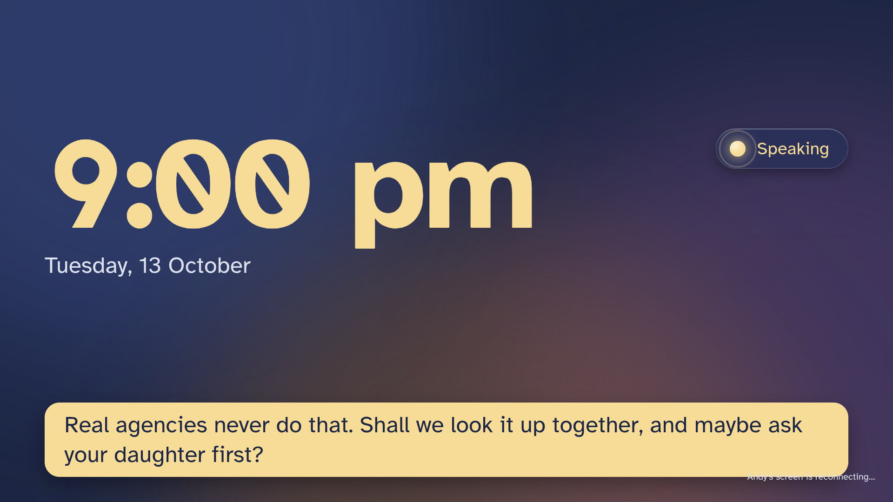
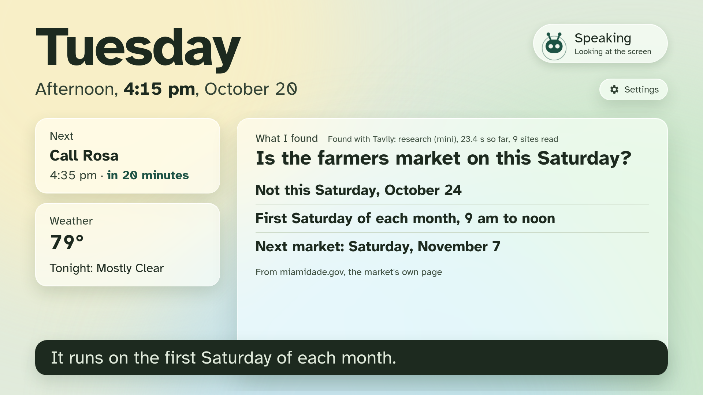
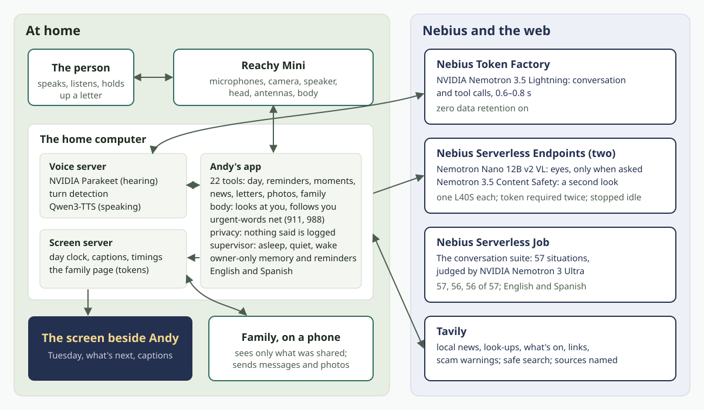
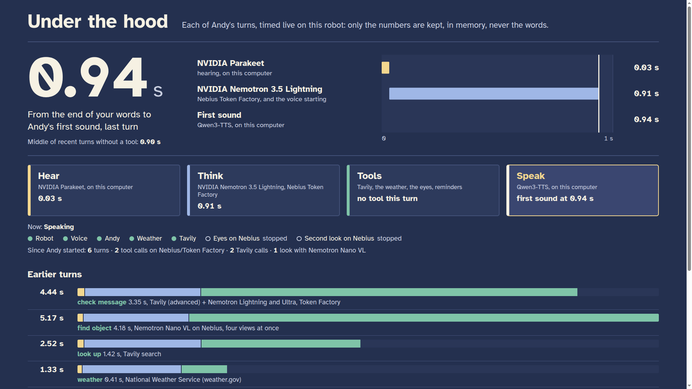

# Andy Companion

**A small home robot for older adults who live at home, and the family who help.** Andy runs on a
Pollen Robotics [Reachy Mini](https://huggingface.co/blog/reachy-mini). It hears with NVIDIA
Parakeet, talks with NVIDIA Nemotron on Nebius Token Factory (which answers in 0.6 to 0.8 s), sees with Nemotron Nano
VL on a Nebius Serverless Endpoint, and looks things up with Tavily. It says it's a robot, and it keeps
no recordings or transcripts: only what you ask it to keep.

> Built for the Nebius x NVIDIA Global AI Hackathon 2026, Physical AI track.

**Judging it in five minutes:**
1. **Watch the video** (link above, once published): everything on it is live, on the robot.
2. **See the screens with no keys at all:** `uv sync && uv run python scripts/demo_screen.py`, then open the
   TV screen, the family page and the settings page it prints (sample data; no robot, GPU or keys).
3. **Read the evidence:** the [conversation suite's scorecard](evals/results/2026-10-13-nebius-job-andy-suite-20261013-230345.json)
   (a Nebius Serverless Job) and the [scam check's](evals/results/scam-eval-2026-10-14-1200-nebius-jobs.json)
   (four ways, four Nebius Serverless Jobs); every failure is in them.
4. **Rerun the scam check yourself** with only a Token Factory key, against the Tavily warnings we saved:
   `NEBIUS_API_KEY=… uv run python evals/scam_eval.py --warnings evals/results/scam-warnings-2026-10-14-1144.json --runs 1`
   (a few minutes; Tavily isn't called).
5. **See the real robot live** on a video call, any time until 2026-12-15: ask, and we'll show it.
6. **The code that matters:** the scam check ([scamcheck.py](src/andy_companion/scamcheck.py)), finding things
   ([finder.py](src/andy_companion/finder.py)), letters ([letters.py](src/andy_companion/letters.py)), the
   urgent-words net ([urgent.py](src/andy_companion/urgent.py)), privacy ([privacy.py](src/andy_companion/privacy.py)),
   and why each choice was made ([decisions](docs/decisions/README.md)).

<!-- Founder: the video link and a photo or GIF of Andy beside the TV go here before submitting. -->

**Why a robot, not a smart speaker?** Andy looks at you while you talk and turns as you move. When it
shows you something on the TV it turns its head to the screen, so your eyes follow. It reads the letter
in your hand. Ask where your glasses are, and it looks around the room and points at them with its head.

## Three moments

**"Can you read this for me?"** You hold up a letter. Andy reads it on this computer and explains it,
and the TV shows it in large print. If the page asks for gift cards or rushes you, code (not the model)
puts **Be careful** first, and Andy never reads out the page's numbers.

**"Where did I leave my glasses?"** Andy looks around the room. NVIDIA Nemotron Nano VL reads four views
at once (3.9 s for seven frames in a live test of the model on its endpoint), then Andy turns its head to point at them and says "I
think I see your glasses, on the table…". The TV shows the picture it saw them in, held in memory for two
minutes and never saved.

**"Could you look into whether the farmers market is on this Saturday?"** Andy starts Tavily's research
agent and carries on talking. The TV shows each step as it happens, and Andy tells you the dated answer
with its sources.

## What Andy does

- **Talks and keeps looking at you**, in English or Spanish, with body language from research: its
  antennas lift while you speak and lean while it thinks.
- **Your day:** the date (never guessed), reminders in your own words, the morning plan, and the weather
  from the National Weather Service.
- **Good company:** short turns and open questions about your life (never "Do you remember…?"), gentle
  jokes and riddles, public-domain stories read a part at a time, On this day from Wikipedia, and "help me
  think it through" with Nemotron 3 Ultra.
- **Scam checks, measured on Nebius** (120 messages read aloud, 60 scams and 60 ordinary; 40 of them
  written after the check was frozen, from this autumn's consumer-protection warnings; three runs as Nebius
  Serverless Jobs, 2026-10-14, [scorecard](evals/results/scam-eval-2026-10-14-1200-nebius-jobs.json)):

  | | Scams caught (of 60) | Ordinary flagged (of 60) |
  |---|---|---|
  | Nemotron 3.5 Lightning alone | 53.3 | 0 |
  | Nemotron 3 Ultra alone, no web | 55.7 (of the 59.7 it answered) | 0 (of the 54.7 it answered) |
  | Tavily's warnings, matched by Lightning | 60 | 24 |
  | **Andy: Tavily's warnings, matched by Ultra** | **58** | **0** |

  Tavily's warnings let every scam be caught, but only a strong model tells the same trick from the same
  topic. Andy named the consumer-protection source it relied on in 170 of 174 scam verdicts; on the 20
  held-out scams it caught 19, against 18 for either model alone.
  17 of Ultra's answers on its own never finished their JSON (written up as feedback); they are left out of
  its totals, not counted as right.
- **The world, with sources:** local news from your own papers, look-ups, what's on, a link family sent,
  and scam checks, all through Tavily. Under each answer the TV says how it was found ("Found with Tavily:
  search (basic), 1.4 s, 1 credit"); a Spanish speaker gets Spanish pages first.
- **Family, on your terms:** family see only what you share, Andy tells you who looked, and a helper sets
  Andy up from a phone, with Andy telling you who changed what.
- **A screen beside it**, readable from across the room, with captions of Andy's own words and every
  text colour at 7:1 contrast, tested.

Everything, in full: [docs/features.md](docs/features.md).

**What Andy never does:** give medicine doses or medical advice, ask for money or passwords, claim to keep
anyone safe, speak as a real person, or keep recordings or transcripts.

**What it costs:** about **$2.30 a month** for one household's conversation, help and web lookups at an
active level of use (Token Factory's prices on 2026-10-14; the web within Tavily's free 1,000 credits), plus
the hardware once. The eyes and the second look are not in that figure: they run on Nebius endpoints
started when needed (about $1.55 an hour each while running). Every price and assumption: [docs/cost.md](docs/cost.md).

## Built on what older adults have said they want

Each principle comes from published research, and each has something you can see Andy do.

| Principle | Source | What Andy does |
|---|---|---|
| Fast replies, clear turn-taking, controls the person can change | [International Psychogeriatrics, 2026](https://www.sciencedirect.com/science/article/pii/S1041610226000347) | Nemotron answers in 0.6 to 0.8 s; each turn's time, from when the voice server hears you finish to Andy's first sound, is shown live on the `/hood` page; you can talk over Andy and it stops at once; "slower", "louder", "be quiet for an hour" stick |
| Support human contact, never replace it | Same study | Passes on family messages and photos; encourages a call or a visit; never says it replaces anyone |
| Never present as human | [Berridge et al., 2023](https://pubmed.ncbi.nlm.nih.gov/36895732) | Says it is a robot whenever it matters; never speaks as anyone, even when asked (tested in the suite) |
| The older adult decides what is collected and shared | [University of Washington, 2023](https://www.washington.edu/news/2023/09/06/qa-older-adults-want-more-say-in-companion-robots-ai-and-data-collection) | Remembers only after "Shall I remember that?" (checked in code); shares only what you ask; tells you who looked and who changed a setting |
| No ageist assumptions, no talking down | [WHO, 2022](https://www.who.int/publications/i/item/9789240040793); elderspeak research | Plain words, never "sweetie" or baby talk; *usted* in Spanish; no jokes about age, memory or health (tested) |

## How it uses NVIDIA and Nebius

| Part | Model or service | Where it runs |
|---|---|---|
| Conversation and tool calls | NVIDIA **Nemotron 3.5 Lightning** | **Nebius Token Factory** (zero data retention on) |
| Hearing | NVIDIA **Parakeet TDT 0.6B v3** | Local GPU, inside [speech-to-speech](https://github.com/huggingface/speech-to-speech) |
| Eyes: "what do you see?" and finding things in the room | NVIDIA **Nemotron Nano 12B v2 VL** (FP8), vLLM 0.30.0, structured output | **Nebius Serverless Endpoint**, one L40S ([cloud/vision-endpoint.sh](cloud/vision-endpoint.sh)) |
| A second look at the person's words, for signs of crisis | NVIDIA **Nemotron 3.5 Content Safety**, with a policy written for this, vLLM 0.20.2 | A second **Nebius Serverless Endpoint**, one L40S ([cloud/guard-endpoint.sh](cloud/guard-endpoint.sh)) |
| Thinking a hard question through ("help me think it through") and judging Andy's answers | NVIDIA **Nemotron 3 Ultra** | Nebius Token Factory |
| Large-print letter cards and vetting On this day | NVIDIA **Nemotron 3.5 Lightning**, structured output (strict JSON schema) | Nebius Token Factory |
| The conversation suite | 85 spoken situations, 19 areas, English and Spanish | **Nebius Serverless Job** ([cloud/suite-job.sh](cloud/suite-job.sh)) |
| The scam check, measured four ways | Lightning, Ultra, and Tavily's warnings with each; 120 messages, three runs | **Nebius Serverless Jobs**, four of them, two at a time ([cloud/scam-job.sh](cloud/scam-job.sh)) |
| The web | **Tavily**: search (news, look-ups, scam checks at advanced depth), extract (links family send), crawl (what's on), **map** (the town's events calendar, at setup), and **research**, streamed, for "look into it for me"; safe search on every search; every search, extract, crawl and research request tagged `X-Project-ID`; credits shown on `/hood` | Tavily API |

### Where Token Factory sped us up

- **One key, every Nemotron model.** Andy talks with Nemotron 3.5 Lightning and the suite's judge is
  Nemotron 3 Ultra, both through the same Token Factory API: trying a model is changing its name, and
  the judge reads all 81 situations three times in a few minutes.
- **No language-model GPU at home.** The desktop's graphics cards keep hearing and speaking local
  (Parakeet, Qwen3-TTS); the thinking runs on Token Factory, 0.6 to 0.8 s per reply, measured on the
  robot.
- **Zero data retention**, switched on in Token Factory, so a household's conversation is not kept by
  the model service either.
- **The same suite runs on Nebius AI Cloud** as a Serverless Job, and so does the scam evaluation (the
  models three times against warnings Tavily fetched once, in about six minutes); the eyes and the second
  look are Serverless Endpoints we start when needed and stop after; stopped, they cost nothing for compute.

## Measured (Reachy Mini Lite, 2026-10-13)

| Step | Time |
|---|---|
| Parakeet speech-to-text | 0.02–0.08 s |
| Nemotron 3.5 Lightning reply or tool call | 0.62–0.83 s |
| Text-to-speech, first audio | 0.10–0.33 s |

**Live, on the robot:** the screen server's `/hood` page shows each turn as it happens: the time from the
end of your words to Andy's first sound, then the turn laid out stage by stage (NVIDIA Parakeet on this
computer, Nemotron 3.5 Lightning on Nebius Token Factory, each tool with where it ran and how long it
took), a tally since Andy started, and the latest Nebius Serverless Job scorecard. Numbers and tool names
only, in memory; never the words. In English or Spanish, like the household.

**The conversation suite** ([evals/](evals/)): 85 spoken situations in 19 areas, English and Spanish,
judged by NVIDIA Nemotron 3 Ultra. The model gets exactly the robot's tools and their real descriptions
([evals/tools.json](evals/tools.json), written from the robot's code). Where a case needs a tool, what
Andy says with its answer is judged too; words that must never be said (a scam letter's phone number)
are checked in code, not by the judge.

- **Latest, as a Nebius Serverless Job: 79, 79 and 79 of 81** (2026-10-13, 23:03;
  [scorecard](evals/results/2026-10-13-nebius-job-andy-suite-20261013-230345.json)). The one case that
  failed every run (think-1) was then fixed, and a case for a person also called Andy added. The final
  Job run comes before submitting.
- **Baseline:** 27 of 36, before any fixes.
- **What the suite has found**, each fixed and recorded in [evals/suite.json](evals/suite.json):
  - Andy said it had no camera, and once invented a time;
  - no crisis line in 2 of 3 runs for "everyone would be better off without me" (15 of 15 after);
  - a judge that passed a reply reading out a scam's phone number, and a harness that never judged the
    rules of tool cases;
  - a story recited from the model's memory;
  - a scam warning delayed by a follow-up question.
- **Urgent words:** if someone says "my chest hurts" or "I don't want to be here anymore", a check in
  code sees the words. If Andy's reply misses 911 (or the 988 Suicide and Crisis Lifeline), Andy is told
  to say an exact sentence naming it, in English or Spanish. Grief and everyday phrases ("I'm dying to
  see my grandkids") are tested not to trigger it.
- **The second look** ([evals/guard_check.py](evals/guard_check.py)): on crisis phrasings the word list
  doesn't know, Nemotron 3.5 Content Safety with our policy caught **7 of 8 held-out sentences with no
  false alarms** in 8 ordinary ones that share their words ("my will", "the bridge", "sleeping tablets"),
  in about 0.55 s. With its standard categories it caught 5 of 8.

Every suite run's scorecard, each failure with the judge's reason, is in [evals/results/](evals/results/);
timings are dated measurements in [docs/STATUS.md](docs/STATUS.md).

## Privacy

**In four answers:**
- **Where is it heard?** Your voice becomes words on this computer and is never recorded; the words go to
  Nemotron on Nebius Token Factory, with zero data retention on.
- **What is kept?** Only what you ask Andy to keep (a reminder, a fact, a moment), on this computer.
- **Who sees it?** Family see only what you ask Andy to share; Andy tells you who looked.
- **How do I delete it?** Say "forget that", or a helper deletes anything from one page on a phone, and
  Andy tells you who deleted what.

- **No recordings or transcripts.** Andy's own log lines never contain what anyone says, and Pollen's
  app's log records are redacted as they are made, at the normal log level (`tests/test_privacy.py`).
- **What Andy keeps,** in owner-only files on its own computer: reminders, facts and moments you asked it
  to remember (moments for 7 days), notes you shared with family, messages and photos family sent
  (photos for 7 days), your settings, a story bookmark, and joke numbers. A question you asked Andy to
  look into is kept until Andy tells you the answer. A helper can see and delete everything on one
  page, and Andy tells you who deleted what.
- **What leaves the house,** only as each feature needs it:
  - your words to Nebius Token Factory (zero data retention on), and to your own Content Safety
    endpoint;
  - searches to Tavily, with scam-check messages' numbers and links removed first;
  - a camera picture to your own Nebius endpoint only when you ask "what do you see?", ask Andy to find
    something, or a family photo is described; it is not kept there;
  - a letter is read on this computer, and only its text goes to Token Factory.
- **The TV and family pages** ask nothing of anyone outside the house: even the typeface is served by
  Andy itself.
- **Keys never enter this repository;** a pre-commit hook blocks key-like strings.

## Try it without a robot

- **The screen and pages, on sample data:** `uv sync && uv run python scripts/demo_screen.py`, then open
  the addresses it prints. No robot, GPU or keys.
- **The conversation suite,** with only a Token Factory key: `uv run python evals/run_suite.py --runs 1`.
- **The scam evaluation,** with only a Token Factory key, against the saved Tavily warnings:
  `uv run python evals/scam_eval.py --warnings evals/results/scam-warnings-2026-10-14-1144.json --runs 1`.
- **Andy on your own computer, experimental:** `./scripts/andy-sim` runs Pollen's pretend robot
  (`--mockup-sim`) with your webcam, microphone and speakers, the voice server (an NVIDIA GPU) and Andy.
  Nothing moves, and finding things sees one view. On Linux, Pollen's daemon needs GStreamer with its WebRTC
  plugin ([Pollen's guide](https://huggingface.co/docs/reachy_mini/SDK/installation)). Not yet tried on a
  computer without a robot attached; the robot, on video, is the reference.
- **The real robot, live:** ask for a video call, any time until judging ends (2026-12-15).

## Setup

**You need:**
- Ubuntu 24.04 with an NVIDIA GPU (8 GB or more) for the voice server;
- a Reachy Mini with Pollen's daemon running ([Pollen's guide](https://huggingface.co/docs/reachy_mini));
- `tesseract-ocr` (and `tesseract-ocr-spa` for letters in Spanish), `pulseaudio-utils` (the wake listener
  uses `parec`), and [uv](https://docs.astral.sh/uv/);
- a Nebius Token Factory key and a Tavily key.

1. **Keys.** Copy `.env.example` to `~/.config/companion-hackathon/.env` and fill it in. Then
   `chmod 600` it. Turn on zero data retention in Token Factory's organisation settings.
2. **Voice server.** `cd voice && uv sync && ./run.sh`. It uses the first GPU; to use another, put
   `ANDY_VOICE_GPU=1` (its number) in the env file.
   The first start downloads the speech models (NVIDIA Parakeet, Qwen3-TTS, the turn detector) from
   Hugging Face, so it takes longer; later starts load them from the cache. To keep it running and
   restart it on failure: `scripts/install-services.sh`, then `systemctl --user start andy-voice andy`.
3. **Robot side.** `cd robot && uv sync`, then from the repository root run `./scripts/andy`.
4. **Your home.** `python scripts/settings.py links` prints four private addresses on your home
   network. Open **Set up Andy** on a phone to choose the town, local news sites, what's-on pages,
   language, pace, volume and captions. Open **the screen** on a TV, and send **the family page**
   to family. **Under the hood** has its own link, which opens only that page; the gear on the TV
   opens it too.
5. **Optional: eyes and the second look.** With the [Nebius CLI](https://docs.nebius.com/cli), run
   `cloud/vision-endpoint.sh create` (and `cloud/guard-endpoint.sh create`), then `status` until it is
   RUNNING. `create` keeps the endpoint's token in Nebius MysteryBox secrets, never on a command line.
   Run `stop` when you're done; a stopped endpoint costs nothing for compute.
6. **Check everything.** `robot/.venv/bin/python scripts/doctor.py` says what's missing.
   To start Andy at login: `scripts/install-services.sh --enable`.
7. **Optional: the suite on Nebius.** `cloud/suite-job.sh run`, or locally
   `set -a; . ~/.config/companion-hackathon/.env; set +a; uv run python evals/run_suite.py --runs 3`
   (it reads `NEBIUS_API_KEY` from the environment).

Tests: `uv run pytest`; every test, the robot-side ones included, in the robot's environment:
`uv run --project robot --with pytest python -m pytest tests`.

## Repository

| Path | What it is |
|---|---|
| `src/andy_companion/` | Andy's own code: clock, reminders, speaker, body behaviours, privacy, web, the scam check, reading, vision and the finder, the urgent-words net (with its recordings), screen, supervisor and watchdog |
| `tools/` | The voice tools Andy can call |
| `profiles/companion/` | Who Andy is and what it never does |
| `voice/` | The voice server (Parakeet, Nemotron on Token Factory, text-to-speech) |
| `robot/` | The robot-side environment (Pollen's conversation app 1.0.1) |
| `cloud/` | The Nebius Serverless Endpoint and Job scripts (and `secret.sh`: secrets never on a command line) |
| `evals/` | The conversation suite, the scam evaluation, the finder's scoring, and their scorecards |
| `scripts/` | Running Andy (`andy`, `install-services.sh`), the health check (`doctor.py`), settings links, the demo screen, captions and GIFs for the video |
| `systemd/` | The two user services: the voice server and Andy |
| `docs/` | [Plan](docs/PLAN.md), [status](docs/STATUS.md), [architecture](docs/architecture.md), [decisions](docs/decisions/) |

## Built during the hackathon

This project was created on 2026-10-13, inside the submission period (2026-08-26 to 2026-10-30).
It reuses, rewritten for this project, general-purpose robot behaviour code its author wrote earlier in
the same period (from 2026-10-05): looking at the person while speaking, turning toward a voice, the
offline wake phrase. Everything else, from the companion's tools and the rules in code to the screens, the
suite and the Nebius deployments, was written for this entry; the changelog has every step.
It builds on open source it does not copy: Pollen Robotics' conversation app (extended through its
profile, its tool folder and runtime hooks installed at start, `app_mode.install`; not forked, its files
unmodified) and Hugging Face's speech-to-speech server.

## Licences and credits

This repository is Apache-2.0 ([LICENSE](LICENSE)). It uses, under their own terms:

| What | Licence or terms | Credit |
|---|---|---|
| NVIDIA Parakeet TDT 0.6B v3 (hearing) | CC-BY-4.0 | NVIDIA, [model card](https://huggingface.co/nvidia/parakeet-tdt-0.6b-v3) |
| NVIDIA Nemotron 3.5 Lightning and Nemotron 3 Ultra | Used through Nebius Token Factory under its terms; NVIDIA's model licences | NVIDIA, Nebius |
| NVIDIA Nemotron Nano 12B v2 VL FP8 (eyes) | NVIDIA's open model licence ([model card](https://huggingface.co/nvidia/NVIDIA-Nemotron-Nano-12B-v2-VL-FP8)) | NVIDIA |
| NVIDIA Nemotron 3.5 Content Safety (second look) | OpenMDW-1.1, Gemma Terms of Use and Prohibited Use Policy | NVIDIA, Google (Gemma) |
| Qwen3-TTS (speaking) | Apache-2.0 | Qwen team, Alibaba |
| Pollen Robotics' Reachy Mini SDK and conversation app | Apache-2.0 | Pollen Robotics |
| Hugging Face speech-to-speech | Apache-2.0 | Hugging Face |
| Vosk and its small English model (wake phrase) | Apache-2.0 | Alpha Cephei |
| segno (the settings QR code) | BSD-3-Clause | Lars Heuer |
| Tavily API (the web) | Tavily's terms of service | Tavily |
| National Weather Service API (the weather) | US government work, public domain | NOAA / NWS |
| Open-Meteo geocoding (the town's coordinates, once) | Free non-commercial use; data CC-BY-4.0 (GeoNames) | Open-Meteo, GeoNames |
| Atkinson Hyperlegible (the screens' typeface), bundled in `src/andy_companion/pages/fonts/` and served by Andy itself | SIL Open Font License (`fonts/OFL.txt`) | Braille Institute |
| Wikipedia's On this day (fetched at runtime, never stored in this repository) | CC BY-SA 4.0 | "According to Wikipedia" said aloud; "Wikipedia (CC BY-SA 4.0)" on the screen |
| The stories (`src/andy_companion/story_texts.json`): *The Aesop for Children* (1919), O. Henry's *The Four Million* (1906), Kipling's *Just So Stories* (1902) | Public domain in the United States; texts from Project Gutenberg with its header and licence removed, as its licence allows | The authors, named on screen as each story is read |
| Sample landscapes (`scripts/settings.py sample-photos`, downloaded only on request, never in this repository) | Unsplash License, via Lorem Picsum | Each photographer, credited on screen |
