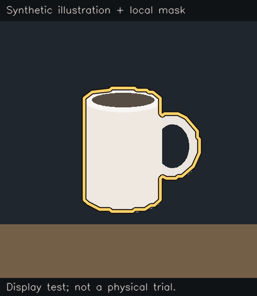

# Optional object outline

After Nemotron confirms the closer view, Andy can draw a gold contour around that object on the
screen copy. This is display assistance: it never supplies a sighting, changes a head angle, turns
a miss into a find or replaces the existing close-up confirmation. The contour is a model estimate.



The example uses our own illustration and a real request to an existing local mask service. It is
not a camera frame or a physical finding result. The SAM 3.1 service supplied its mask; its weights
were not independently verified during this probe. We acknowledge Meta's SAM materials for that
service result. The 0.321-second request is one diagnostic, not a latency or accuracy benchmark.

## Enable only with a compatible service

Off by default. This repository includes the client, **not a SAM model server or weights**. The
normal installation works without them. A separately operated, licensed mask service must implement
the interface below and discard requests without logging/keeping images or object labels. The
operator supplies that service and verifies it processes locally without forwarding requests;
a loopback address alone does not establish the server's internal behavior. This is not a
self-contained SAM installation guide.

1. Verify the service is on this computer and uses a free port, distinct from Andy's screen (8090)
   and voice (8765). Check GPU capacity separately; do not start competing robot apps or model servers.
2. In the private env file, set `ANDY_OUTLINE_URL=http://127.0.0.1:8096`, replacing 8096 with the
   service's actual port. Only numeric loopback HTTP with an explicit port is accepted. This example
   does not start a server. Remove the setting to disable it.
3. Restart only the existing Andy service when the computer/robot is available for Andy. During
   another app's session, leave services and ports unchanged. Never run two robot controllers.
4. On an agreed staged object, check that the contour surrounds the same object Nemotron confirmed.
   Also test absent objects, two nearby look-alikes, timeout and cancellation. A miss must stay a miss;
   no usable mask must leave the normal picture. Keep these checks separate from the finder benchmark.

SAM 3.1 is separately licensed under the [SAM License](https://huggingface.co/facebook/sam3.1/blob/main/LICENSE),
not this repository's Apache-2.0 licence. Its [upstream setup](https://github.com/facebookresearch/sam3#installation)
describes model prerequisites; it does not provide this small HTTP interface. No third-party code,
weights, credentials or additional package dependency is bundled here. NVIDIA/Nebius remain the
normal conversation/vision path. The public sample screens do not run this service.

## Local service interface

`POST /segment`, JSON request:

```json
{"image": "base64-JPEG", "query": "mug", "min_score": 0.5}
```

The JPEG is the confirmed close-up only, reduced to at most 1024 pixels on either side. All returned
coordinates refer to that JPEG. The fixed request contains no transcript, conversation history or key.

HTTP 200 response, for an invented 320×200 image:

```json
{"masks": [{"box": [80, 40, 240, 160], "score": 0.91,
  "outline_scale": [2, 2], "outline": "M 0 0 L 80 0 L 70 50 L 40 60 L 10 50 Z"}]}
```

`box` is `[left, top, right, bottom]`; `outline_scale` maps box-local path coordinates to JPEG pixels.
Only closed absolute `M`/`L`/`Z` polygons are supported. Paths are decoded into bounded numeric points
and painted as pixels; provider SVG/HTML is never inserted in the page. A score of at least 0.5 and
exactly one qualifying mask containing Nemotron's confirmed point are required. Scene-sized, tiny,
unsupported, out-of-bounds, missing or ambiguous contours leave the original image. This conservative
rule can omit a valid contour, especially on thin things or masks with gaps.

The client disables proxies/redirects, caps replies at 256 KiB, accepts at most 12 masks/16 components
per mask and 512 total path points per mask, and uses a 0.8-second **per network operation** timeout.
That timeout is not an end-to-end latency guarantee. No new cloud call is made. Cancellation while
awaiting the mask prevents that worker from publishing a late picture; an already sent backend
request may still finish. The annotated JPEG follows the existing authenticated, two-minute RAM-only
view route and clearing behavior. It is never added to the optional finder-recording files.

## Verification and remaining work

Invented-mask, actual loopback HTTP, proxy/redirect, invalid geometry, input-preservation, fallback,
confirmation-only, remembered-place and cancellation tests accompany the implementation. No household
picture was used in the service probe. The setting remains disabled in the running household.

Observed camera/voice/pointing tasks with this option, mask alignment at different distances,
concurrent deletion during an in-flight request, crowded/absent scenes and end-to-end timing still
need verification before filming or claiming a physical improvement. Existing physical finder
results are unchanged. See [STATUS.md](STATUS.md) and [the live test](live-test.md).
